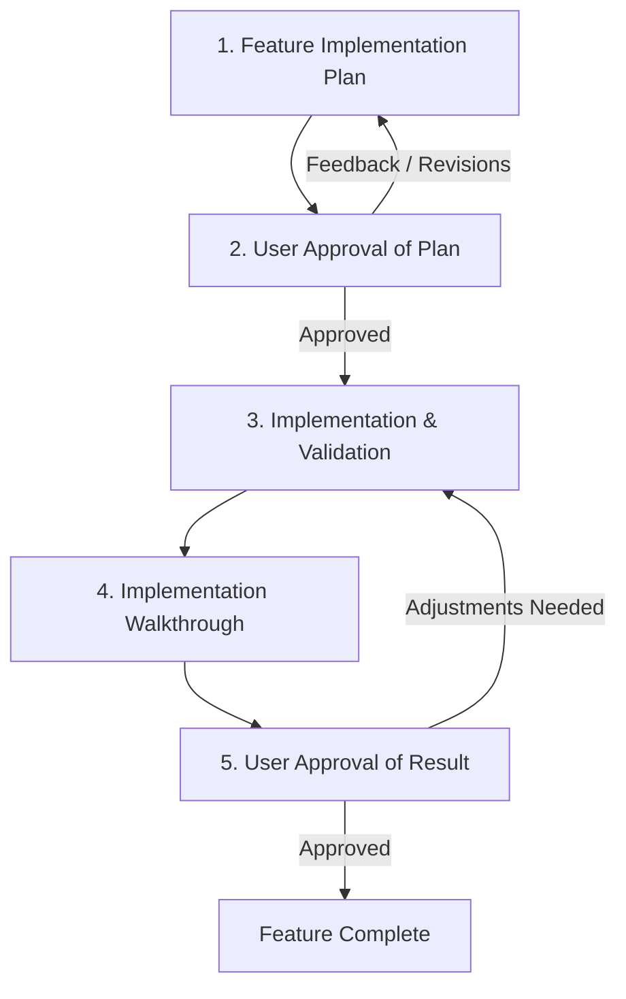

# Feature Implementation Workflow (Rust / Golem)

This skill defines the required 5-stage lifecycle for designing, approving, implementing, validating, and reviewing features in this Rust Golem repository.

## Workflow Overview



---

## Stage 1: Feature Implementation Plan

Before modifying any source code or writing implementation files:

1. **Determine Feature Identifier**:
   - Establish a clean, lowercase kebab-case slug for the feature or issue: `<feature_name_or_id>` (e.g. `user-timeline-cache`, `chat-reaction-agent`, `issue-42`).
2. **Deep Research**:
   - Inspect existing agent definitions (`src/`), traits annotated with `#[agent_definition]`, structs with `#[derive(Schema)]`, and inter-agent RPC patterns.
   - Inspect `golem.yaml` component declarations, `httpApi`, `mcp`, and environment configurations.
   - Inspect relevant Golem Rust skills (e.g., `golem-add-agent-rust`, `golem-build`, `golem-call-another-agent-rust`, `golem-add-http-endpoint-rust`, `golem-http-params-rust`).
   - Identify any crate dependencies needed in `Cargo.toml` and verify `wasm32-wasip2` compatibility.
3. **Draft the Plan**:
   - Ensure the directory `docs/implementation/` exists.
   - Write the plan to:
     ```text
     docs/implementation/<feature_name_or_id>_feature_plan.md
     ```
   - Reference [feature_plan_template.md](./resources/feature_plan_template.md) for structure.
   - The plan MUST include:
     - **Overview & Goals**: What the feature accomplishes and why.
     - **Architecture & Design**: Agent traits, Schema types, state persistence, RPC/HTTP endpoints, and concurrency/durability model.
     - **File-by-File Changes**: Categorized with `[NEW]`, `[MODIFY]`, or `[DELETE]`.
     - **Verification Plan**: Exact commands to run for formatting, type checking, clippy linting, Golem build, unit tests, and runtime/smoke checks.
     - **Risks & Open Questions**: Known trade-offs or technical decisions.

---

## Stage 2: User Approval of Plan (Gate 1)

**DO NOT proceed with code implementation until explicit user approval is received.**

1. Present a concise summary of the proposed plan in the chat.
2. Provide a direct link to the plan file:
   - `[Feature Plan](docs/implementation/<feature_name_or_id>_feature_plan.md)`
3. Ask the user for review and approval:
   > "Please review the implementation plan. If everything looks good, please approve to proceed with implementation, or let me know what you would like to adjust."
4. If the user provides feedback or requests changes:
   - Update `docs/implementation/<feature_name_or_id>_feature_plan.md`.
   - Re-request approval until confirmed.

---

## Stage 3: Implementation & Validation

Once user approval is granted:

1. **Implement Changes**:
   - Execute the changes incrementally, following the approved plan.
   - Adhere to Golem Rust constraints:
     - Target is `wasm32-wasip2` (no native platform threads or unsandboxed syscalls).
     - Component crate type must be `cdylib` in `Cargo.toml`.
     - Agent traits annotated with `#[agent_definition]`.
     - Method arguments and return types passed by value with `#[derive(Schema, ...)]`.
     - Durability by default; let Golem handle automatic retries for host operations (HTTP, RPC, DB).
   - Update `golem.yaml` if endpoints, agents, MCP tools, or presets need changes.
2. **Run Rigorous Validation**:
   - **Code Formatting**:
     ```bash
     cargo fmt --check
     ```
     Verify that all code complies with formatting standards. Use `cargo fmt` to auto-format.
   - **Type Checking / Compilation**:
     ```bash
     cargo check --target wasm32-wasip2
     ```
     Verify zero Rust compilation or type errors for the WebAssembly target.
   - **Linter Verification (Clippy)**:
     ```bash
     cargo clippy --target wasm32-wasip2
     ```
     Verify zero clippy errors or warnings.
   - **Golem Build**:
     ```bash
     golem build --yes
     ```
     Verify that the WASM component bundle builds cleanly and Golem metadata is correctly generated.
   - **Automated Unit & Integration Tests**:
     ```bash
     cargo test
     ```
     Execute automated Rust unit and integration tests (where applicable).
   - **Integration / Smoke Verification**:
     Run integration scripts or verify agent invocations via CLI:
     ```bash
     golem agent invoke '<agent_name>(...)' '<component>/<agent_name>.{<method>}' '<args>'
     ```
     Or test HTTP API endpoints:
     ```bash
     curl -s http://localhost:9006/<path>
     ```
3. **Fix Any Regressions**:
   - If any validation check fails, diagnose and resolve the issue immediately before moving forward.

---

## Stage 4: Implementation Walkthrough

Once implementation and all validation checks pass:

1. Create the walkthrough document at:
   ```text
   docs/implementation/<feature_name_or_id>_implementation_walkthrough.md
   ```
2. Reference [walkthrough_template.md](./resources/walkthrough_template.md) for structure.
3. The walkthrough MUST document:
   - **Executive Summary**: High-level outcome of the implementation.
   - **Changes Implemented**: Detailed list of modified/created files with clickable file links.
   - **Validation Results**: Actual output or proof of success for:
     - Formatting: `cargo fmt --check`
     - Compilation: `cargo check --target wasm32-wasip2`
     - Linter: `cargo clippy --target wasm32-wasip2`
     - Golem Build: `golem build --yes`
     - Unit/Integration Tests: `cargo test` (or test scripts)
     - Runtime smoke verification (e.g. `golem agent invoke`, HTTP curl requests)
   - **Verification / Usage Guide**: Step-by-step instructions for how the user can test or interact with the feature.

---

## Stage 5: User Approval of Result (Gate 2)

1. Present the completed results to the user in chat.
2. Provide a direct link to the walkthrough:
   - `[Implementation Walkthrough](docs/implementation/<feature_name_or_id>_implementation_walkthrough.md)`
3. Summarize key validation findings and ask for final sign-off:
   > "Implementation and validation are complete. Please review the walkthrough and let me know if you approve or if any further adjustments are needed."
