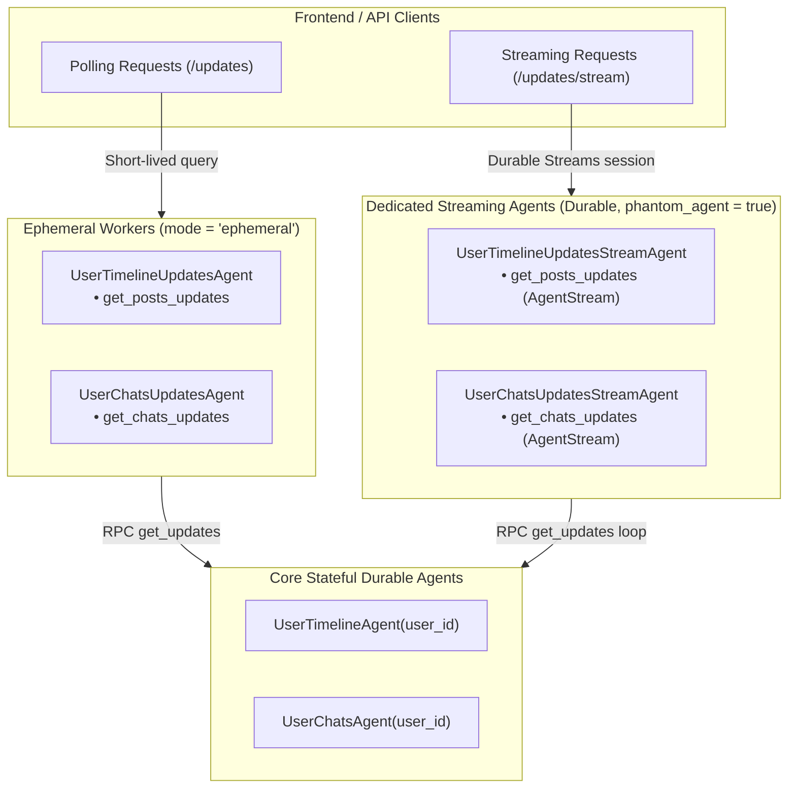

# Feature Plan: Specific Streaming Agents for Timeline and Chat Updates

- **Feature ID / Slug**: `specific-streaming-agents`
- **Date**: 2026-10-27
- **Status**: Completed <!-- Draft | Approved | In Progress | Completed -->

---

## 1. Overview & Goals

Currently, `UserTimelineUpdatesAgent` and `UserChatsUpdatesAgent` are defined as ephemeral agents (`mode = "ephemeral"`). They contain both polling endpoints (`get_posts_updates`, `get_chats_updates`) and streaming endpoints (`get_posts_updates_stream`, `get_chats_updates_stream`).

Ephemeral workers get a fresh instance per invocation, lack long-lived durable state, and do not durably suspend (failing at `ephemeral_max_sleep` limits). In Golem's Durable Streams protocol, an HTTP client first establishes a session via `PUT` and subsequently tails/reads from SSE slots (`/invocations/{session}/streams/$result`). Because ephemeral workers discard state and cannot reliably drive long-lived background producer loops (`spawn_local` with `wstd::task::sleep`), stream-bearing endpoints fail or behave unpredictably under ephemeral execution.

### Goals

1. **Introduce Dedicated Streaming Agents**:
   - Create `UserTimelineUpdatesStreamAgent` for timeline post update streams.
   - Create `UserChatsUpdatesStreamAgent` for chat update streams.
2. **Simplified Method Naming**:
   - Inside the streaming agents, remove the `_stream` suffix from method names since the agent itself is dedicated to streaming:
     - `UserTimelineUpdatesStreamAgent::get_posts_updates` returning `AgentStream<PostRef>`
     - `UserChatsUpdatesStreamAgent::get_chats_updates` returning `AgentStream<ChatRef>`
3. **Durable & Concurrent Worker Model**:
   - Configure the streaming agents as durable workers with `phantom_agent = true`. Each stream session receives a dedicated, durable worker that can sleep, poll, and yield items over its lifetime without blocking other users or requests.
4. **Preserve Ephemeral Polling Agents**:
   - Keep `UserTimelineUpdatesAgent` and `UserChatsUpdatesAgent` strictly for request-response / long-polling (`get_posts_updates` and `get_chats_updates`), removing the streaming methods from them.
5. **Maintain Full API Compatibility**:
   - Keep the existing HTTP URL paths unchanged:
     - `GET /v1/social-net/users/{user_id}/timeline/posts/updates/stream`
     - `GET /v1/social-net/users/{user_id}/chats/updates/stream`
   - Keep frontend client compatibility in `frontend/src/api.ts`.
6. **Update Application Manifest**:
   - Register `UserTimelineUpdatesStreamAgent` and `UserChatsUpdatesStreamAgent` in `golem.yaml` under `httpApi.deployments.local.agents`.
7. **Update Architecture Documentation in `README.md`**:
   - Document the new streaming agents and explain the real-time synchronization architecture combining polling and Durable Streams.

### Non-Goals

- Changing the underlying `stream_updates` utility function logic in `src/common/mod.rs` (it already correctly yields `AgentStream<T>` via `spawn_local`).
- Modifying the polling API contracts or changing data models (`PostRef`, `ChatRef`).
- Updating `BLOG_POST.md`.

---

## 2. Architecture & Technical Design

### Agent Separation Architecture



### Key Decisions

1. **Dedicated Agent Types vs Shared Ephemeral Agents**:
   - *Decision*: Separate streaming into `UserTimelineUpdatesStreamAgent` and `UserChatsUpdatesStreamAgent`.
   - *Rationale*: Ephemeral mode cannot support long-lived background sleep loops or durable stream reconnects. Dedicated agents clearly separate the lifecycle of ephemeral request handlers from long-lived durable streaming workers.
2. **Naming Convention**:
   - *Decision*: Agent names are `UserTimelineUpdatesStreamAgent` and `UserChatsUpdatesStreamAgent`. Method names are `get_posts_updates` and `get_chats_updates` (dropping the redundant `_stream` suffix since the agent itself is dedicated to streaming).
   - *Rationale*: Clean, idiomatic Rust API design.
3. **Durable with `phantom_agent = true`**:
   - *Decision*: Define streaming agents with `#[agent_definition(mount = "/v1/social-net/users", phantom_agent = true, cors = ["*"])]`.
   - *Rationale*: If a streaming agent were a singleton (`new() -> Self` without phantom), all clients and users would queue behind a single worker thread. By using `phantom_agent = true`, each stream connection spawns an isolated durable worker instance with its own phantom ID. This allows concurrent streams across users and multiple tabs per user without interference.
4. **HTTP Mount Path Consistency**:
   - *Decision*: Mount at `/v1/social-net/users` with endpoint paths matching the existing routes (`.../updates/stream`).
   - *Rationale*: Eliminates breaking changes for clients such as `frontend/src/api.ts` or generated OpenAPI consumers.
5. **Registration in `golem.yaml`**:
   - *Decision*: Add `UserTimelineUpdatesStreamAgent` and `UserChatsUpdatesStreamAgent` to `httpApi.deployments.local.agents`.
   - *Rationale*: Required by Golem CLI to generate HTTP routing rules and expose agent endpoints.

---

## 3. Proposed Changes & File Impact

| Action     | File Path                                          | Description |
| :--------- | :------------------------------------------------- | :---------- |
| `[MODIFY]` | [`src/user_timeline/mod.rs`](file:///Users/coon/workspace-zv/git/golem-social-net-rust/src/user_timeline/mod.rs) | Remove `get_posts_updates_stream` from `UserTimelineUpdatesAgent`. Define and implement `UserTimelineUpdatesStreamAgent` with `get_posts_updates`. |
| `[MODIFY]` | [`src/user_chats/mod.rs`](file:///Users/coon/workspace-zv/git/golem-social-net-rust/src/user_chats/mod.rs) | Remove `get_chats_updates_stream` from `UserChatsUpdatesAgent`. Define and implement `UserChatsUpdatesStreamAgent` with `get_chats_updates`. |
| `[MODIFY]` | [`golem.yaml`](file:///Users/coon/workspace-zv/git/golem-social-net-rust/golem.yaml) | Add `UserTimelineUpdatesStreamAgent` and `UserChatsUpdatesStreamAgent` under `httpApi.deployments.local.agents`. |
| `[MODIFY]` | [`README.md`](file:///Users/coon/workspace-zv/git/golem-social-net-rust/README.md) | Document `UserTimelineUpdatesStreamAgent` and `UserChatsUpdatesStreamAgent` under Architecture Components and Real-time Synchronization. |

### Detailed Changes

#### `src/user_timeline/mod.rs`
- In `UserTimelineUpdatesAgent` and `UserTimelineUpdatesAgentImpl`:
  - Remove `get_posts_updates_stream` method.
- Add `UserTimelineUpdatesStreamAgent` trait:
  ```rust
  #[agent_definition(mount = "/v1/social-net/users", phantom_agent = true, cors = ["*"])]
  pub trait UserTimelineUpdatesStreamAgent {
      fn new() -> Self;

      #[endpoint(
          get = "/{user_id}/timeline/posts/updates/stream?since={since}&iter-wait-time={iter_wait_time}"
      )]
      fn get_posts_updates(
          &mut self,
          user_id: String,
          since: Option<String>,
          iter_wait_time: Option<u32>,
      ) -> golem_rust::agentic::AgentStream<PostRef>;
  }
  ```
- Implement `UserTimelineUpdatesStreamAgent` for `UserTimelineUpdatesStreamAgentImpl` using `stream_updates`.

#### `src/user_chats/mod.rs`
- In `UserChatsUpdatesAgent` and `UserChatsUpdatesAgentImpl`:
  - Remove `get_chats_updates_stream` method.
- Add `UserChatsUpdatesStreamAgent` trait:
  ```rust
  #[agent_definition(mount = "/v1/social-net/users", phantom_agent = true, cors = ["*"])]
  pub trait UserChatsUpdatesStreamAgent {
      fn new() -> Self;

      #[endpoint(
          get = "/{user_id}/chats/updates/stream?since={since}&iter-wait-time={iter_wait_time}"
      )]
      fn get_chats_updates(
          &mut self,
          user_id: String,
          since: Option<String>,
          iter_wait_time: Option<u32>,
      ) -> golem_rust::agentic::AgentStream<ChatRef>;
  }
  ```
- Implement `UserChatsUpdatesStreamAgent` for `UserChatsUpdatesStreamAgentImpl` using `stream_updates`.

#### `golem.yaml`
- Update `httpApi.deployments.local.agents` to include:
  ```yaml
        UserChatsUpdatesStreamAgent: {}
        UserTimelineUpdatesStreamAgent: {}
  ```

#### `README.md`
- In `### Agents`, add subsection for Streaming Agents:
  ```markdown
  #### Streaming Agents (Durable / Phantom)
  - **User Timeline Updates Stream Agent**: Streams live post updates for a user's timeline using Golem Durable Streams (SSE).
  - **User Chats Updates Stream Agent**: Streams live chat and message updates for a user using Golem Durable Streams (SSE).
  ```
- In `5. Real-time Synchronization`:
  - Document both long-polling (`UserTimelineUpdatesAgent`, `UserChatsUpdatesAgent`) and streaming via Golem Durable Streams (`UserTimelineUpdatesStreamAgent`, `UserChatsUpdatesStreamAgent`).

---

## 4. Verification Plan

### Automated Checks

1. **Code Formatting**:
   ```bash
   cargo fmt --check
   ```
2. **Compilation & Type Check (`wasm32-wasip2`)**:
   ```bash
   cargo check --target wasm32-wasip2
   ```
3. **Clippy Linter**:
   ```bash
   cargo clippy --target wasm32-wasip2
   ```
4. **Golem Component Build**:
   ```bash
   golem build --yes
   ```
5. **Cargo Unit Tests**:
   ```bash
   cargo test
   ```

### Manual / Integration Verification

1. Verify generated component manifest traces and openapi definitions:
   - Check that `golem component manifest-trace` or `golem build` updates the component endpoints.
2. Verify HTTP routes for streaming and updates via local server or CLI.

---

## 5. Risks & Open Questions

- **Risk**: Route collisions between agents mounted at `/v1/social-net/users`.
  - *Mitigation*: Golem HTTP API matches endpoints by specific subpath. `/{user_id}/timeline/posts/updates` (ephemeral) and `/{user_id}/timeline/posts/updates/stream` (durable phantom) have distinct paths and will not conflict.
